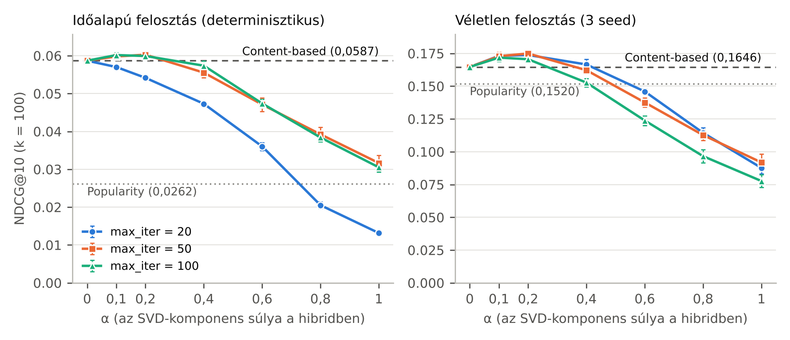

# Offline összehasonlítás – eredmények és értelmezés

> Helye a repóban: `docs/06_release/evaluation_results.md`
> Evidence: `eval_results.csv` (aggregált tábla), `konkret_peldak.txt` (konkrét felhasználói példák kimenete), `sweep_temporal_summary.csv` és `sweep_random_summary.csv` (érzékenységi vizsgálat, 3 seed átlag ± szórás), `sweep_alpha_ndcg.png` (az 5. fejezet ábrája)
> Futtatás és paraméterek: `EVALUATE_GUIDE.md`

## 1. Mérési felállás

| Elem | Érték |
|---|---|
| Adathalmaz | MovieLens ml-latest-small |
| Felosztás | felhasználónként az időrendben legkésőbbi 20% a teszt halmaz (`--test-ratio 0.2`), minimum 5 értékelés (`--min-ratings 5`) |
| Méret | 80 896 train és 19 940 teszt értékelés; 610 teszt felhasználó, ebből 591-nél van legalább egy releváns teszt film |
| Jelölthalmaz | a train halmazban legtöbbet értékelt 500 film (`--candidate-pool-size 500`), a felhasználó már értékelt filmjei nélkül; mind a négy módszerre azonos |
| Releváns elem | a teszt halmazban ≥4,0 értékelést kapott film |
| Metrikák | Precision@10, Recall@10, NDCG@10; csak az SVD-re RMSE és MAE |
| Reprodukálhatóság | `--seed 42`, determinisztikus felosztás; a webes felület `random.sample` változatossága az offline mérésben nem szerepel. A seedek közötti szórást az 5. fejezet (érzékenységi vizsgálat) méri |

**Adatszivárgás elleni szabály.** A teszt értékelések nem kerülnek vissza a modell tanításába, a népszerűségi számlálásba, a jelölthalmaz építésébe és a felhasználó kedvelt filmjeinek összeállításába. A teszt filmek csak a találatok kiértékeléséhez kellenek.

**SVD-modell.** A `svd.pkl` userId-i nem egyeztek a MovieLens userId-kkal, ezért a script a train halmazból újratanította a modellt (610 user, 7 457 item; `k=100`, `max_iter=20`, `lr=0.01`, `λ=0.02`). Az 5. fejezet ezt a hangolatlan beállítást variálja.

## 2. Összehasonlító tábla (top-10, 591 felhasználó)

| Modell | Precision@10 | Recall@10 | NDCG@10 | RMSE | MAE |
|---|---:|---:|---:|---:|---:|
| Popularity | 0,0220 | 0,0258 | 0,0262 | – | – |
| **Content-based** | **0,0462** | **0,0414** | **0,0587** | – | – |
| SVD | 0,0134 | 0,0072 | 0,0130 | 0,8862 | 0,6851 |
| Hybrid (α = 0,6) | 0,0294 | 0,0245 | 0,0364 | – | – |

Az RMSE/MAE csak az SVD-nél értelmezhető, mert csak ez ad értékelés-előrejelzést.

## 3. Értelmezés

1. **A tartalomalapú módszer nyer.** A Content-based a népszerűségi alapvonalhoz képest nagyjából kétszeres Precision@10-et és NDCG@10-et ér el (0,0462 és 0,0220, illetve 0,0587 és 0,0262), a Recall@10 pedig 0,0414 a 0,0258-cal szemben. Ez az egyszerű népszerűségi listához képest mérhető többletet jelent a személyre szabásra.
2. **Az SVD a legrosszabb rangsoroló, miközben az előrejelzése elfogadható.** RMSE = 0,8862 és MAE = 0,6851 mellett a top-10 rangsorolása a Popularity alatt van. Ez a jelenség a szakirodalomban ismert: az előrejelzési hibára optimalizált modell nem feltétlenül jó top-N feladatban (Cremonesi, Koren és Turrin, 2010).
3. **A Hybrid a Popularity-nél jobb, de a Content-based-nél gyengébb.** Az SVD-komponens (α = 0,6) ezen az adaton rontja a tiszta tartalomalapú eredményt, nem kiegészíti. Vilmos szerint sem elvárás, hogy a hibrid mindenhol nyerjen.

### Lehetséges okok az SVD gyengeségére

A fő táblázatban az SVD hangolatlan (`max_iter = 20`). Az 5. fejezet érzékenységi vizsgálata alapján az okok így értékelhetők:

- **Alulillesztettség – részben igazolt.** Az iterációszám 20-ról 50-re emelése az időalapú felosztáson több mint a duplájára növeli az SVD NDCG@10-ét (0,0132 → 0,0317), de a hangolt SVD is csak az 54%-át éri el a Content-based eredményének (0,0587). Így az alulillesztettség a nagyon alacsony kiindulási értéket magyarázza, a Content-based-hez mért lemaradást nem. 100 iterációnál az eredmény nem javul tovább (0,0305), az RMSE pedig romlik.
- **A k hatása elhanyagolható.** `k = 32, 50, 100` között az iter = 50 beállításnál a különbségek a szórás nagyságrendjében vannak (5.2).
- **Jelölthalmaz népszerűségi torzítása.** Az 500 leggyakrabban értékelt filmből álló jelölthalmaz a népszerűségi szignálnak kedvez, az SVD erőssége viszont a kevésbé nyilvánvaló találatokban lenne. A jelölthalmaz méretének hatását korábban ellenőriztük: 500-ról 9 999-re növelve az SVD mutatói nem javultak, tovább romlottak (a Content-based kicsit javult). A jelölthalmaz mérete tehát nem a fő ok.
- **Ritka adat.** A felhasználók többségének kevés értékelése van, ez a kollaboratív szűrés ismert gyenge pontja. Ezt a mérés nem választja el külön, ezért az okok közül ez a legkevésbé ellenőrzött.
- **Véletlen felosztáson az SVD a hangolás után is a Popularity alatt marad** (a legjobb SVD NDCG@10 = 0,0918, a Popularity 0,1520), tehát ez nem csak a hangolatlan beállítás sajátossága.

## 4. Konkrét felhasználói példák (top-20)

A példák a `--example-user-ids 116,26,235,91,176,100` futásból származnak, top-20 ajánlással (nem a top-10 táblával azonos K). A ★ jelöli, ha az ajánlott film a felhasználó teszt halmazában releváns (≥4,0) volt.

| userId | Train értékelés (kedvelt) | Releváns teszt film | Popularity | Content-based | SVD | Hybrid |
|---:|---:|---:|---:|---:|---:|---:|
| 116 | 70 (32) | 7 | 0 | 2 | 0 | 2 |
| 26 | 17 (3) | 4 | 2 | 1 | 0 | 1 |
| 235 | 52 (29) | 9 | 3 | 0 | 0 | 0 |
| 91 | 460 (182) | 56 | 9 | 3 | 5 | 6 |
| 176 | 29 (21) | 5 | 3 | 1 | 0 | 0 |
| 100 | 119 (85) | 22 | 0 | 2 | 1 | 1 |

A cellák a top-20-on belüli találatok számát mutatják.

### Hol segített a személyre szabás

- **#116 (Content-based és Hybrid 2–2 találat, Popularity és SVD 0).** A felhasználó kedvelt filmjei (pl. Congo, Crimson Tide, The Client, Forrest Gump) akció- és thriller-ízlésre utalnak. A Content-based és a Hybrid ezzel összhangban a Gladiator és a Pirates of the Caribbean filmeket találta el. A Popularity általános slágerlistát adott, az SVD pedig régebbi klasszikusokat (Lawrence of Arabia, North by Northwest), amelyek közül egy sem volt releváns.
- **#100 (Content-based 2, SVD és Hybrid 1, Popularity 0).** A kedvelt filmek (Sense and Sensibility, Persuasion, Mr. Holland's Opus) drámai, romantikus ízlést mutatnak. A Content-based a Bridget Jones's Diary és a Catch Me If You Can filmeket találta el, a Popularity egyet sem.
- **#91 (minden módszer talált).** Ez az aktív, adatgazdag felhasználó (460 értékelés). Az SVD (5) és a Hybrid (6) is érdemben teljesít, és részben más filmeket talált el (Spirited Away, Shaun of the Dead), mint a Popularity. Itt a Popularity vitt 9 találattal, mert a felhasználó ízlése a népszerű filmeket is lefedi.

### Hol nem segített

- **#235 és #176 (Popularity 3–3 találat, a személyre szabott módszerek 0 vagy 1).** A kedvelt filmek (pl. The American President, Get Shorty, Babe) és a releváns teszt filmek (Silence of the Lambs, Terminator 2, Independence Day) között nincs olyan műfaji vagy tartalmi kapcsolat, amit a profil megragadna. Itt a népszerű filmek közül jött a találat.
- **#26 (kevés adat: 17 train értékelés, csak 3 kedvelt film).** A három kedvelt film szűk profilt ad. A Popularity 2, a Content-based és a Hybrid 1 találatot ért el, az SVD nullát. Kevés adattal a személyre szabás nem tud érdemben előnyt szerezni.
- **SVD több felhasználónál.** Az SVD ajánlásai mindegyik példában ugyanazt a szűk klasszikus-halmazt ismétlik (Lawrence of Arabia, Rear Window, Great Escape, Life Is Beautiful, Boondock Saints). Ez az alulillesztett, kevés iterációval tanult modellre jellemző viselkedés: a felhasználótól függetlenül csaknem azonos lista jön, ezért gyakran 0 találat. A példák a hangolatlan beállítással (`max_iter = 20`, hibrid α = 0,6) készültek; a hangolt konfigurációval (5. fejezet) nem lettek újrafuttatva.

## 5. Érzékenységi vizsgálat: SVD-hiperparaméterek, hibrid α, több seed

A fő tábla (2. fejezet) egyetlen felosztáson, hangolatlan SVD-vel készült. Ennek két bizonytalanságát vizsgálja ez a fejezet: az SVD gyenge eredménye a módszer vagy a beállítás korlátja, és mekkora a szórás a felosztás és a seed szerint.

### 5.1 Felállás

| Elem | Érték |
|---|---|
| Seedek | 42, 43, 44; a táblákban a 3 seed átlaga ± mintaszórása (n−1) szerepel |
| SVD-rács | `k` ∈ {100, 50, 32} × `max_iter` ∈ {20, 50, 100}; `lr = 0,01`, `λ = 0,02` rögzített; minden konfiguráció a train halmazból tanul (a `svd.pkl` nem kerül felhasználásra) |
| Hibrid α | {0; 0,1; 0,2; 0,4; 0,6; 0,8; 1}, minden SVD-konfigurációra. **Az α az SVD-komponens súlya**: α = 0 a tiszta Content-based, α = 1 a tiszta SVD |
| Felosztás A | `temporal`: felhasználónként az időrendben legkésőbbi 20%. Determinisztikus, a seed csak az SVD inicializálását változtatja, ezért a Popularity és a Content-based szórása 0 |
| Felosztás B | `random`: felhasználónként véletlenszerű 20%. A seed a felosztást is változtatja, így a felosztás szórása is látszik |
| Közös | top-10, 500 elemű jelölthalmaz, releváns ≥ 4,0, 591 (temporal) illetve átlagosan 595,7 (random) kiértékelt felhasználó |

Az időalapú felosztás a fő (az előrejelzés a felhasználó későbbi értékeléseire vonatkozik, ez áll közelebb a valós használathoz), a véletlen felosztás robusztussági ellenőrzés. **A két felosztás abszolút értékei nem hasonlíthatók össze.**

Ellenőrzés a fő táblával: az időalapú sweep `k = 100`, `max_iter = 20` sora (SVD P@10 = 0,0137; Hybrid α = 0,6 NDCG@10 = 0,0360) a 3 seed átlaga, és egyezik a seed 42 futás értékeivel (0,0134; 0,0364) a seedek közti szórás keretein belül. A Popularity és a Content-based sora a 4 tizedesjegyig pontosan megegyezik a fő táblával.

### 5.2 SVD hangolása

NDCG@10, 3 seed átlaga ± szórás.

**Időalapú felosztás**

| k \ max_iter | 20 | 50 | 100 |
|---|---:|---:|---:|
| 100 | 0,0132 ± 0,0007 | 0,0317 ± 0,0020 | 0,0305 ± 0,0012 |
| 50 | 0,0112 ± 0,0009 | 0,0300 ± 0,0028 | 0,0285 ± 0,0011 |
| 32 | 0,0104 ± 0,0002 | 0,0316 ± 0,0008 | 0,0277 ± 0,0017 |

**Véletlen felosztás**

| k \ max_iter | 20 | 50 | 100 |
|---|---:|---:|---:|
| 100 | 0,0877 ± 0,0044 | 0,0918 ± 0,0063 | 0,0777 ± 0,0049 |
| 50 | 0,0803 ± 0,0063 | 0,0892 ± 0,0033 | 0,0681 ± 0,0028 |
| 32 | 0,0795 ± 0,0067 | 0,0905 ± 0,0024 | 0,0668 ± 0,0013 |

RMSE (3 seed átlaga):

| k | időalapú: 20 | 50 | 100 | véletlen: 20 | 50 | 100 |
|---|---:|---:|---:|---:|---:|---:|
| 100 | 0,8861 | 0,8928 | 0,9017 | 0,8598 | 0,8605 | 0,8657 |
| 50 | 0,8875 | 0,8988 | 0,9210 | 0,8644 | 0,8706 | 0,8943 |
| 32 | 0,8883 | 0,9016 | 0,9356 | 0,8655 | 0,8808 | 0,9195 |

Megállapítások:

- **Az iterációszám 20 → 50 emelése sokat javít, 100 már nem.** Időalapún a `k = 100` sor NDCG@10-e 0,0132 → 0,0317 → 0,0305, véletlen felosztáson 0,0877 → 0,0918 → 0,0777. A legjobb konfiguráció mindkét felosztáson `k = 100`, `max_iter = 50`.
- **A `k` nem meghatározó.** `max_iter = 50` mellett időalapún 0,0317 / 0,0300 / 0,0316 (k = 100 / 50 / 32), véletlen felosztáson 0,0918 / 0,0892 / 0,0905; a különbségek a szórás nagyságrendjében vannak. 100 iterációnál viszont a kisebb `k` rosszabb (véletlen felosztáson 0,0777 → 0,0681 → 0,0668 és az RMSE 0,8657 → 0,9195), tehát a kisebb modell gyorsabban túlilleszkedik.
- **A rangsorolás és az előrejelzés nem ugyanabba az irányba mozog.** Több iterációnál az RMSE romlik (időalapún k = 100: 0,8861 → 0,8928 → 0,9017), miközben a rangsor időalapún jelentősen javul 20 → 50 között. Ez összhangban van azzal, hogy az előrejelzési hibára optimalizált modell nem feltétlenül jó top-N rangsoroló (Cremonesi, Koren és Turrin, 2010).
- **A hangolt SVD időalapún a Popularity fölé kerül** (NDCG@10 = 0,0317 a 0,0262 ellenében; Precision@10 = 0,0260 a 0,0220 ellenében), **véletlen felosztáson viszont mindegyik konfiguráció alatta marad** (legjobb: 0,0918, Popularity: 0,1520).
- **Egyik konfiguráció sem közelíti meg a Content-based-et** (időalapún 0,0317 a 0,0587 ellenében, véletlen felosztáson 0,0918 a 0,1646 ellenében).

### 5.3 Hibrid α-érzékenység

Az alábbi táblák a legjobb SVD-konfigurációt (`k = 100`, `max_iter = 50`) mutatják, mind az α-értékekre. A többi konfiguráció a `sweep_*_summary.csv` fájlokban van.

**Időalapú felosztás**

| Modell | Precision@10 | Recall@10 | NDCG@10 |
|---|---:|---:|---:|
| Popularity | 0,0220 ± 0,0000 | 0,0258 ± 0,0000 | 0,0262 ± 0,0000 |
| Content-based | 0,0462 ± 0,0000 | 0,0414 ± 0,0000 | 0,0587 ± 0,0000 |

| α (SVD súly) | Precision@10 | Recall@10 | NDCG@10 |
|---:|---:|---:|---:|
| 0 (= Content-based) | 0,0462 ± 0,0000 | 0,0414 ± 0,0000 | 0,0587 ± 0,0000 |
| 0,1 | **0,0465 ± 0,0006** | **0,0408 ± 0,0006** | **0,0598 ± 0,0004** |
| 0,2 | **0,0457 ± 0,0002** | **0,0401 ± 0,0002** | **0,0603 ± 0,0005** |
| 0,4 | 0,0448 ± 0,0015 | 0,0386 ± 0,0022 | 0,0555 ± 0,0013 |
| 0,6 | 0,0395 ± 0,0016 | 0,0313 ± 0,0005 | 0,0471 ± 0,0018 |
| 0,8 | 0,0336 ± 0,0009 | 0,0262 ± 0,0006 | 0,0392 ± 0,0019 |
| 1 (= SVD) | 0,0260 ± 0,0006 | 0,0204 ± 0,0010 | 0,0317 ± 0,0020 |

**Véletlen felosztás**

| Modell | Precision@10 | Recall@10 | NDCG@10 |
|---|---:|---:|---:|
| Popularity | 0,1148 ± 0,0038 | 0,0984 ± 0,0056 | 0,1520 ± 0,0059 |
| Content-based | 0,1229 ± 0,0025 | 0,1058 ± 0,0037 | 0,1646 ± 0,0024 |

| α (SVD súly) | Precision@10 | Recall@10 | NDCG@10 |
|---:|---:|---:|---:|
| 0 (= Content-based) | 0,1229 ± 0,0025 | 0,1058 ± 0,0037 | 0,1646 ± 0,0024 |
| 0,1 | **0,1287 ± 0,0027** | **0,1100 ± 0,0066** | **0,1729 ± 0,0031** |
| 0,2 | **0,1299 ± 0,0008** | **0,1116 ± 0,0036** | **0,1749 ± 0,0023** |
| 0,4 | 0,1223 ± 0,0006 | 0,1033 ± 0,0009 | 0,1622 ± 0,0028 |
| 0,6 | 0,1064 ± 0,0032 | 0,0896 ± 0,0015 | 0,1376 ± 0,0035 |
| 0,8 | 0,0884 ± 0,0030 | 0,0720 ± 0,0030 | 0,1127 ± 0,0040 |
| 1 (= SVD) | 0,0740 ± 0,0036 | 0,0574 ± 0,0043 | 0,0918 ± 0,0063 |

Megállapítások:

- **A fő táblában használt α = 0,6 a rosszabbik tartomány.** Mind a 9 SVD-konfigurációnál, mindkét felosztáson a Content-based alatt marad (időalapún NDCG@10 = 0,0341–0,0497 a 0,0587 ellenében; véletlen felosztáson 0,1150–0,1460 a 0,1646 ellenében). Véletlen felosztáson α = 0,6 mellett a hibrid a Popularity (0,1520) alá is kerül.
- **Az α csökkentésével a hibrid a Content-based-hez közelít, α = 0,1–0,2 körül eléri vagy kissé meghaladja azt.** Az α növelése távolítja a Content-based-től.
- **Időalapún a különbség nem megbízható.** α = 0,1–0,2 mellett az NDCG@10 a 9 konfigurációból 6-nál nagyobb a Content-based-nél, a legjobb 0,0610 ± 0,0015 (`k = 32`, `max_iter = 100`, α = 0,2) a 0,0587-es értékkel szemben (+0,0023, +4%). A Precision@10 α = 0,1 mellett 4, α = 0,2 mellett 0 konfigurációnál, a Recall@10 α = 0,1 mellett 1, α = 0,2 mellett 0 konfigurációnál nagyobb. A hibrid tehát a Content-based szintjén van, a javulás a mutatók közt nem következetes. Itt a Content-based szórása 0 (determinisztikus felosztás), a hibrid szórása csak az SVD inicializálását tükrözi.
- **Véletlen felosztáson az előny következetes, de kicsi.** α = 0,1 és α = 0,2 mellett mind a 9 konfiguráció meghaladja a Content-based-et mindhárom mutatón; az NDCG@10 0,1697–0,1749 a 0,1646 ± 0,0024 ellenében (+0,005…+0,010, legjobb: +0,0103, +6%, `k = 100`, `max_iter = 50`, α = 0,2).
- **A kedvező α-tartomány mindkét felosztáson ugyanaz (≈ 0,1–0,2).** Ez az SVD-komponens kis súlya: a hibrid hasznos, ha az SVD csak kiegészíti a tartalmi rangsort.

### 5.4 A két felosztás összevetése

| NDCG@10 | időalapú | véletlen | véletlen / időalapú |
|---|---:|---:|---:|
| Popularity | 0,0262 | 0,1520 | 5,8× |
| Content-based | 0,0587 | 0,1646 | 2,8× |
| legjobb SVD | 0,0317 | 0,0918 | 2,9× |

- **A véletlen felosztás mindhárom módszernek könnyebb, a Popularity-nek a legkönnyebb.** A Content-based előnye a Popularity-vel szemben ezért felosztásfüggő: időalapún 2,2-szeres (0,0587 / 0,0262), véletlen felosztáson 1,08-szoros (0,1646 / 0,1520, a különbség 0,0127 a 0,0059-es és 0,0024-es szórások mellett). A „nagyjából kétszeres" állítás tehát csak az időalapú felosztásra igaz.
- A valószínű ok az, hogy a véletlen felosztás tesztfilmjei ugyanabból az időszakból származnak, mint a train értékelések, ezért a népszerű filmek könnyebben találhatók el. Ezt nem vizsgáltuk külön.
- A módszerek **sorrendje** a két felosztáson megegyezik a legfontosabb pontokon: a Content-based a legerősebb önálló módszer, az SVD a leggyengébb a Content-based-hez képest, és a kis α-jú hibrid a Content-based szintjén vagy kissé fölötte van.

### 5.5 Mit állíthatunk és mit nem

- **Állítható:** a Content-based mindkét felosztáson a legerősebb önálló rangsoroló; az SVD hangolással sokat javul (időalapún ×2,4), de így sem éri el; a hibrid a Content-based szintjére kerül, ha az SVD súlya kicsi (α ≈ 0,1–0,2), míg a korábbi α = 0,6 rontja azt.
- **Nem állítható:** hogy a hibrid érdemben jobb a Content-based-nél. Időalapún a különbség a szórás nagyságrendjébe esik és mutatónként ellentmondó, véletlen felosztáson +3–6% NDCG-ben, 3 seeden.
- **A konfigurációk a teszt halmazon lettek összevetve** (9 SVD-konfiguráció × 7 α), így a legjobb sor értéke optimista. Ezért ez érzékenységi vizsgálat, és nem a teszten kiválasztott „végleges modell" mérése. Az α ≈ 0,1–0,2 tartomány következetessége a konfigurációk és a két felosztás között csökkenti, de nem zárja ki a kiválasztási torzítást.

## 6. Következtetések

- Ezen az adathalmazon a tartalomalapú személyre szabás a legerősebb önálló rangsoroló mindkét felosztáson. Az egyszerű népszerűségi listához képesti előnye az időalapú felosztáson nagy (kb. 2,2×), véletlen felosztáson kicsi (kb. 1,08×), tehát a mérés felosztásától függ.
- Az SVD hangolással sokat javul (időalapún NDCG@10 ×2,4, `max_iter` = 50), de a Content-based-et így sem közelíti meg, és véletlen felosztáson a Popularity alatt marad. A gyenge eredmény ezért nem csak a hangolatlan beállítás következménye.
- A hibrid a Content-based szintjére kerül, ha az SVD súlya kicsi (α ≈ 0,1–0,2). Időalapún a javulás nem megbízható, véletlen felosztáson következetes, de kicsi (+3–6% NDCG@10). A korábbi α = 0,6 beállítás mindkét felosztáson rontja a Content-based eredményét. Az α csökkentése a hibridben ezért megalapozott továbbfejlesztés.
- A személyre szabás haszna nem egyenletes: a felhasználó értékeléseinek számától és ízlésének jellegétől függ. Kevés adatnál vagy a mainstreamtől eltérő ízlésnél a Popularity versenyképes lehet.

## 7. Korlátok

- Egyetlen adathalmaz; a felosztás szórását csak 3 seeden, véletlen felosztással mértük, így a szórásbecslés durva. Az időalapú felosztás szórása csak az SVD inicializálását tükrözi.
- Az SVD-konfigurációk és az α a teszt halmazon lettek összevetve (nincs külön validációs halmaz), ezért a legjobb konfiguráció értéke optimista (5.5).
- Az SVD-ből csak a `k` és a `max_iter` lett hangolva; a tanulási ráta (`lr = 0,01`) és a regularizáció (`λ = 0,02`) rögzített.
- A „kis α-nál a hibrid jobb" állítás szóródása nem lett páros különbségként vizsgálva (a seedenkénti `*_raw.csv` fájlokból megtehető).
- Csak 500 elemű, népszerűségi alapú jelölthalmaz; a korábbi jelölthalmaz-kísérletek alapján nem ez a fő ok, de a long-tail teljesítményt ez a beállítás nem méri jól.
- A Precision/Recall értékei abszolút értelemben alacsonyak (a ritka adat és a kicsi, 10 elemű lista miatt); az összehasonlítás a módszerek egymáshoz viszonyított sorrendjére alkalmas. A két felosztás abszolút értékei nem hasonlíthatók össze.
- A konkrét példák (4. fejezet) 6 felhasználóra vonatkoznak, szemléltetésre valók, nem általánosításra, és a hangolatlan beállítással készültek.
- Az offline mérés a modellek képességét vizsgálja; a webes alkalmazás használhatóságát a felhasználói kipróbálás vizsgálja.

## 8. Továbbfejlesztési irányok

- Külön validációs felosztás a hiperparaméterek és az α kiválasztásához, a teszt halmaz csak a végső méréshez.
- A tanulási ráta és a regularizáció hangolása; a hibrid α alapértelmezett értékének csökkentése (≈ 0,2) az alkalmazásban, majd az eredmények ellenőrzése.
- Páros (seedenkénti) különbségek és több seed a hibrid–Content különbség megbízhatóságához.
- A konkrét példák újrafuttatása a hangolt konfigurációval (a normál mód jelenleg nem fogad SVD- és α-paramétert).
- Nagyobb vagy nem népszerűségi alapú jelölthalmaz vizsgálata.

## Hivatkozás

Cremonesi, P., Koren, Y., & Turrin, R. (2010). Performance of Recommender Algorithms on Top-N Recommendation Tasks. *Proceedings of the 4th ACM Conference on Recommender Systems (RecSys '10)*, 39–46.